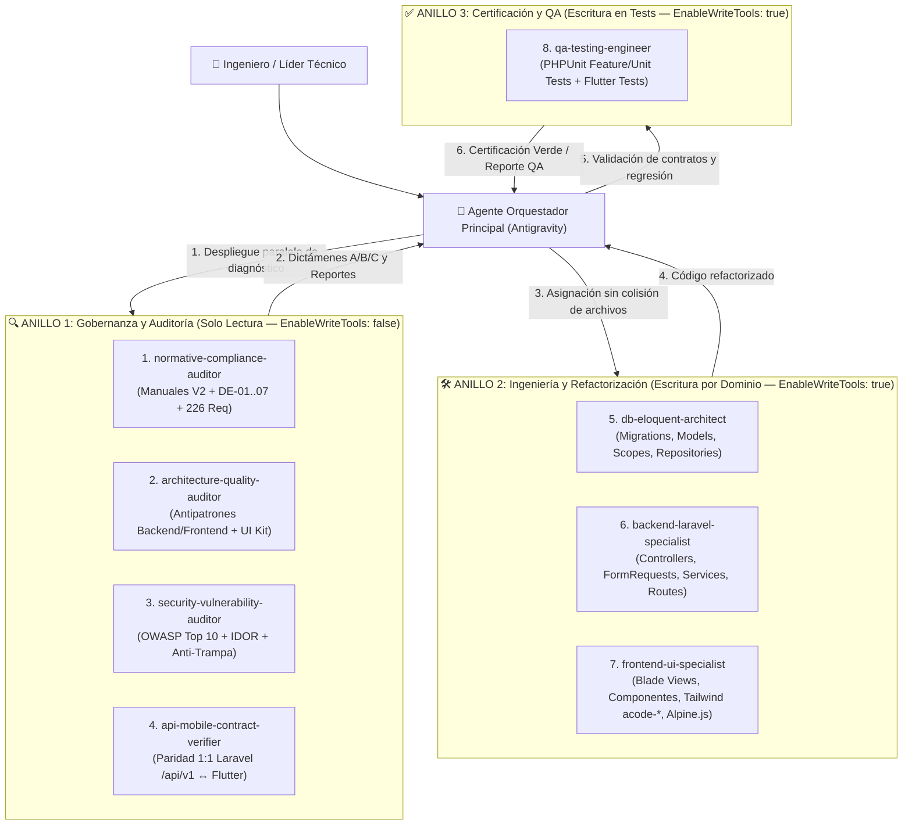
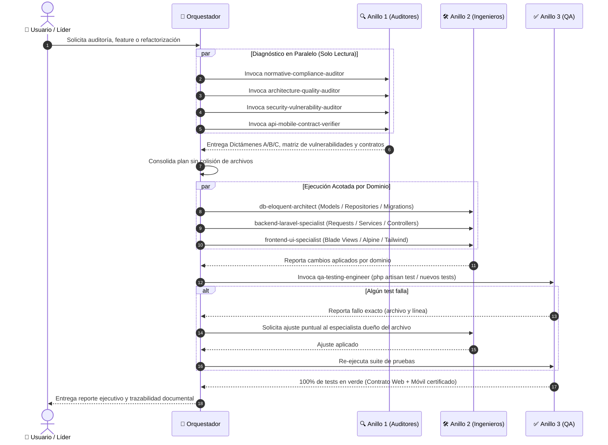

# Manual de Arquitectura de Subagentes y Flujo de Trabajo Automatizado (`MSA-V1`)

> **Organización:** A-Code Solutions — *"Analizamos, diseñamos, transformamos."*  
> **Proyecto:** Ecosistema Evaluador de Exámenes SaaS (`acs-exam-web` + `acs-exam-mobile`)  
> **Código de Documento:** `MSA-V1` (Manual de Subagentes y Automatización Ágil)  
> **Versión:** 1.0 Oficial Homologada con `MPW-V2`, `MPM-V1`, `MC-V2` y `MD-V2`  
> **Fecha de Emisión:** 27 de Octubre de 2026  

---

## 1. Propósito y Alcance del Manual

El presente manual establece la arquitectura operativa, las fronteras de responsabilidad, las reglas de permisos (`Solo Lectura` vs. `Escritura Acotada`) y el **flujo de trabajo multi-agente en 3 anillos** para auditar, mantener, refactorizar y certificar el ecosistema de software de **A-Code Solutions**:

1. **Repositorio Maestro Documental y Normativo (`acode-solutions`)**:
   - Manual de Programación Web con Laravel (`MPW-V2`).
   - Manual de Programación Móvil con Flutter (`MPM-V1`).
   - Manual de Calidad (`MC-V2`) y Manual de Desarrollo (`MD-V2`).
   - Formatos de Ingeniería (`DE-01` a `DE-07`) y `Lista_maestra_requerimientos.xlsx` (226 propuestas).
2. **Plataforma Web y Backend API REST v1 (`acs-exam-web`)**:
   - Monolito modular en Laravel + Blade + Tailwind CSS (`acode-*`) + Alpine.js + Laravel Sanctum.
3. **Aplicación Móvil Multiplataforma (`acs-exam-mobile`)**:
   - Cliente móvil en Flutter consumiendo `/api/v1/*`.

---

## 2. Principios de Diseño de la Topología en 3 Anillos

Para evitar los dos problemas más frecuentes en sistemas multi-agente (**colisiones de edición concurrente** sobre un mismo archivo y **conflicto de interés entre quien programa y quien audita**), el ecosistema se divide en **8 subagentes especializados distribuidos en 3 anillos**:

### Reglas de Oro de la Topología
1. **Separación Juez / Parte**: Ningún agente del **Anillo 1** tiene herramientas de escritura (`EnableWriteTools: false`). Su única misión es auditar con rigor extremo y emitir dictámenes verificables con ruta y línea exacta (`file:///...#LX-LY`).
2. **Partición Disjunta de Directorios en el Anillo 2**: Dos agentes con permisos de escritura **jamás** comparten el mismo directorio de código fuente:
   - `db-eloquent-architect` es dueño exclusivo de `database/**`, `app/Models/**` y `app/Repositories/**`.
   - `backend-laravel-specialist` es dueño exclusivo de `app/Http/**`, `app/Services/**`, `app/Contracts/**`, `app/Jobs/**`, `app/Support/**`, `app/Providers/**` y `routes/**`.
   - `frontend-ui-specialist` es dueño exclusivo de `resources/views/**`, `resources/js/**`, `resources/css/**` y `public/**`.
3. **Certificación Independiente en el Anillo 3**: `qa-testing-engineer` solo puede crear o editar archivos dentro de `tests/**` (`acs-exam-web/tests` y `acs-exam-mobile/test`), pero nunca puede alterar el código de producción para forzar que un test pase.

---

## 3. Catálogo Maestro de los 8 Subagentes

| # | Identificador (`TypeName`) | Anillo | Permisos de Escritura | Dominio Exclusivo de Archivos | Fuentes Normativas Primarias |
| :-: | :--- | :-: | :-: | :--- | :--- |
| **1** | `normative-compliance-auditor` | Anillo 1 | ❌ Solo Lectura | Lectura global (`acode-solutions`, `acs-exam-web`, `acs-exam-mobile`) | `MPW-V2`, `MPM-V1`, `MC-V2`, `MD-V2`, `DE-01..07`, `Lista_maestra_requerimientos.xlsx` |
| **2** | `architecture-quality-auditor` | Anillo 1 | ❌ Solo Lectura | Lectura global (`app/**`, `resources/views/**`, `lib/**`) | `MPW-V2 §2, §3.8, §5, §6, §7, §8` |
| **3** | `security-vulnerability-auditor` | Anillo 1 | ❌ Solo Lectura | Lectura global (`app/**`, `config/**`, `routes/**`, `resources/**`, `lib/**`) | `MPW-V2 §4, §5.6, §6.6`, OWASP Top 10, `RNF-SEG-*`, `RNF-CON-*` |
| **4** | `api-mobile-contract-verifier` | Anillo 1 | ❌ Solo Lectura | `acs-exam-web/routes/api.php`, `app/Http/Controllers/Api/V1/**` ↔ `acs-exam-mobile/lib/**` | `MPW-V2 §6.5`, `MPM-V1`, `RF-API-*`, `MobileContractTest.php` |
| **5** | `db-eloquent-architect` | Anillo 2 | ✅ Escritura | `database/migrations/**`, `database/seeders/**`, `app/Models/**`, `app/Repositories/**` | `MPW-V2 §3.8.1, §4, §5.2.1, §6.6, §6.7`, `02_BASE_DE_DATOS.md` |
| **6** | `backend-laravel-specialist` | Anillo 2 | ✅ Escritura | `app/Http/**`, `app/Services/**`, `app/Contracts/**`, `app/Jobs/**`, `app/Providers/**`, `routes/**`, `docs/**` | `MPW-V2 §2.2, §5.3, §5.6, §6.1..6.5, Tabla 17`, `RF-*` |
| **7** | `frontend-ui-specialist` | Anillo 2 | ✅ Escritura | `resources/views/**`, `resources/css/**`, `resources/js/**`, `public/**` | `MPW-V2 §3.8.2, §5.1.4, §5.2.2, §7, §8, Tabla 20` |
| **8** | `qa-testing-engineer` | Anillo 3 | ✅ Escritura | `acs-exam-web/tests/**`, `acs-exam-mobile/test/**` | `MPW-V2 §9`, `MC-V2`, `DE-05` |

---

## 4. Especificación Funcional Detallada por Subagente

### 4.1. `normative-compliance-auditor` (Auditor Normativo y Documental)
- **Misión**: Garantizar que la documentación oficial de ingeniería (`MPW-V2`, `MC-V2`, `MD-V2`, `DE-01` a `DE-07`), el catálogo de 226 requerimientos (`Lista_maestra_requerimientos.xlsx`) y el código fuente estén 100% sincronizados.
- **Funcionamiento Interno**:
  1. Lee la matriz de requerimientos (`RF-AUT-*`, `RF-GRU-*`, `RF-BAN-*`, `RF-EXA-*`, `RF-APP-*`, `RF-EVA-*`, `RF-IAR-*`, `RF-CAL-*`, `RF-REP-*`, `RF-SEG-*`, `RF-PRI-*`, `RNF-*`).
  2. Contrasta cada regla contra las migraciones, modelos, servicios, controladores y vistas.
  3. Emite obligatoriamente un **Dictamen Tripartito** por cada hallazgo:
     - **Dictamen A (`CORREGIR_CODIGO`)**: El manual o requerimiento es correcto y el código tiene un incumplimiento, omisión o bug.
     - **Dictamen B (`DOCUMENTAR_ADR_DE06`)**: El código implementó una solución técnica superior o más moderna que el manual original (por ejemplo, diseño polimórfico `questionable` de 5 tablas en lugar de una tabla plana `question_options`, o Laravel 13 sobre PHP 8.3). Indica cómo registrarlo en `docs/04_DECISIONES_ADR.md` y en `DE-06_Registro_de_cambios.docx`.
     - **Dictamen C (`ACTUALIZAR_MANUAL`)**: El manual `.docx` tiene una errata, tabla desactualizada o contradicción que debe corregirse en la siguiente versión del documento.
- **Cuándo invocarlo**: Antes de cada entrega o revisión de sprint (`DE-05` / `DE-07`), o tras agregar nuevas funcionalidades al sistema.

---

### 4.2. `architecture-quality-auditor` (Auditor de Arquitectura y Calidad de Código)
- **Misión**: Detectar antipatrones de diseño, deuda técnica, violaciones de responsabilidad única (SRP), problemas de rendimiento (N+1) y desviaciones del estándar de codificación y diseño visual de A-Code Solutions.
- **Funcionamiento Interno**:
  - **En Backend (`acs-exam-web`)**:
    - Verifica que los controladores sean *Skinny Controllers* (< 80 líneas, cero lógica de negocio y cero `$request->validate()` inline).
    - Comprueba la existencia de `declare(strict_types=1);` y el orden canónico de **16 bloques** en clases PHP (`MPW-V2 §3.8.1 Tabla 6`).
    - Detecta consultas dentro de bucles (`foreach`/`map`), ausencia de `with()`/`withCount()`, paginación en memoria y ciclos `while`/`do-while` sin cota máxima `$maxAttempts` (`MPW-V2 §5.2.1`).
    - Identifica código muerto (clases/métodos nunca invocados) y duplicación DRY entre controladores Web y API v1.
  - **En Frontend (`resources/views/**`)**:
    - Detecta bloques `@php ... @endphp` con lógica o consultas, bucles `@foreach` sin `@empty` (deben usar `@forelse`), colores fuera de los tokens `acode-*` y botones que no usen los **18 verbos normativos** de `MPW-V2 §7.8 Tabla 20`.
- **Cuándo invocarlo**: Durante revisiones de código (*Code Reviews* `DE-05`) o antes de iniciar una refactorización mayor.

---

### 4.3. `security-vulnerability-auditor` (Auditor de Seguridad y Vulnerabilidades)
- **Misión**: Proteger el ecosistema contra vulnerabilidades OWASP Top 10, fugas de información entre docentes/alumnos (IDOR) y trampas durante la aplicación de exámenes.
- **Funcionamiento Interno**:
  1. **Auditoría de Autorización e IDOR**: Revisa que todo endpoint que reciba IDs (`{exam}`, `{group}`, `{question}`, `{attempt}`, `group_ids.*`) valide que el recurso pertenezca al docente o alumno autenticado.
  2. **Auditoría del Motor de Examen (`MPW-V2 §5.6.1`)**:
     - Comprueba la validación server-side de la ventana de examen (`starts_at` / `ends_at`) y del cronómetro (`started_at + duration_minutes`).
     - Verifica que un alumno no pueda re-enviar respuestas sobre intentos finalizados (`status !== 'in_progress'`) ni saltar el orden secuencial de preguntas.
     - Verifica que los payloads JSON/HTML hacia el alumno jamás filtren `correct_answer`, `is_correct` ni puntajes de IA no revisados por el docente (`RF-EVA-009`).
  3. **Auditoría de Autenticación y Sesiones**: Revisa `random_int()` en 2FA, expiración de códigos, invalidación de sesión + regeneración CSRF en `logout`, rate limiting (`throttle`) y almacenamiento seguro en móvil (`FlutterSecureStorage`).
- **Cuándo invocarlo**: Ante cualquier cambio en autenticación, intentos de examen, calificaciones o permisos de grupos/exámenes.

---

### 4.4. `api-mobile-contract-verifier` (Verificador de Contratos API v1 y App Móvil)
- **Misión**: Garantizar paridad 1:1 entre el backend Laravel (`/api/v1/*`) y la app móvil Flutter (`acs-exam-mobile`), previniendo errores de serialización o pantallas rotas en Android/iOS.
- **Funcionamiento Interno**:
  1. Cruza `routes/api.php` y los 7 controladores `App\Http\Controllers\Api\V1\*` con `lib/core/network/api_endpoints.dart`, modelos Dart (`fromJson`) y repositorios de Flutter.
  2. Verifica que el sobre `ApiResponse` (`status`, `data`, `message`, `errors`) y los tipos de cada propiedad (`int`, `double`, `bool`, `String?`, listas anidadas de `questions` y `options`) coincidan exactamente con lo que Dart parsea.
  3. Audita el manejo de códigos HTTP (`200`, `201`, `401`, `403`, `404`, `409`, `422`) en ambos lados.
- **Cuándo invocarlo**: Siempre que se modifique un controlador `Api\V1`, un FormRequest consumido por API, `AttemptService` o cualquier modelo/pantalla en `acs-exam-mobile`.

---

### 4.5. `db-eloquent-architect` (Arquitecto de Base de Datos, Modelos y Repositorios)
- **Misión**: Construir y mantener la capa de datos (`migrations`, `seeders`, `Models`, `Scopes`, `Repositories`) limpia, tipada y libre de consultas N+1.
- **Dominio de Escritura**:
  - `database/migrations/**`
  - `database/seeders/**`
  - `app/Models/**` (incluyendo `app/Models/Scopes/TenantTeacherScope.php`)
  - `app/Repositories/Contracts/**` y `app/Repositories/Eloquent/**`
- **Responsabilidades Clave**:
  - Garantizar `declare(strict_types=1);` y el orden canónico de 16 bloques en los 22 modelos Eloquent.
  - Implementar scopes de aislamiento multi-docente (`scopeForTeacher` y `TenantTeacherScope`).
  - Implementar repositorios Eloquent que encapsulen consultas complejas con `with()`, `withCount()` y `paginate()`.

---

### 4.6. `backend-laravel-specialist` (Especialista Backend Laravel)
- **Misión**: Implementar y refactorizar controladores *Skinny*, Form Requests normativos, Servicios transaccionales y políticas de negocio en `acs-exam-web`.
- **Dominio de Escritura**:
  - `app/Http/Controllers/**` (Web y `Api/V1`)
  - `app/Http/Requests/**`
  - `app/Http/Middleware/**`
  - `app/Services/**`, `app/Contracts/**`, `app/Jobs/**`, `app/Support/**`, `app/Providers/**`
  - `routes/**` y `docs/**`
- **Responsabilidades Clave**:
  - Erradicar cualquier `$request->validate()` inline moviéndolo a clases `FormRequest` con mensajes en español según la Tabla 17 de `MPW-V2`.
  - Encapsular toda operación multi-tabla dentro de `DB::transaction()` en `app/Services/`.
  - Mantener la paridad entre el flujo Web y el flujo API v1 reutilizando los mismos Servicios de dominio (`AuthService`, `AttemptService`, `ExamAssemblyService`, `QuestionBankService`, `GroupEnrollmentService`, `TeacherGradingService`).

---

### 4.7. `frontend-ui-specialist` (Especialista Frontend Web y UI Kit A-Code)
- **Misión**: Desarrollar y refactorizar las vistas Blade, componentes reutilizables `<x-...>` e interactividad Alpine.js / Chart.js / SweetAlert2 conforme a las secciones §7 y §8 del `MPW-V2`.
- **Dominio de Escritura**:
  - `resources/views/**`, `resources/js/**`, `resources/css/**`, `public/**`
- **Responsabilidades Clave**:
  - Eliminar lógica PHP o consultas de las vistas Blade.
  - Estandarizar el uso de `@forelse ... @empty`, tokens institucionales `acode-*` y los 18 verbos de acción oficiales de la Tabla 20 del `MPW-V2`.
  - Mantener la robustez del reproductor de examen web (cronómetro sincronizado, cámara anti-trampa, detección de cambio de pestaña/ventana y bloqueo de retroceso).

---

### 4.8. `qa-testing-engineer` (Ingeniero de Pruebas Automatizadas y Certificación QA)
- **Misión**: Escribir y ejecutar pruebas automatizadas (`php artisan test` y `flutter test`) que certifiquen que todas las reglas de negocio, validaciones, controles de seguridad IDOR y contratos móviles funcionen sin regresiones.
- **Dominio de Escritura**:
  - `acs-exam-web/tests/**` (`Feature` y `Unit`)
  - `acs-exam-mobile/test/**`
- **Responsabilidades Clave**:
  - Mantener siempre en verde `tests/Feature/Api/MobileContractTest.php`.
  - Crear suites de pruebas para cada fase de refactorización (aislamiento entre docentes, calificación proporcional de relación de columnas, respuestas abiertas vacías sin consumo de IA, bloqueo de cierre de grupo con exámenes en curso, expiración de tiempo de examen, etc.).

---

## 5. Flujo de Trabajo Operativo Paso a Paso (Ciclo Completo)

Cada vez que se requiera desarrollar un nuevo módulo, auditar un entregable o refactorizar el sistema, se ejecuta el siguiente flujo de 4 etapas:

---

## 6. Ubicación Física y Persistencia de los Subagentes

Para que los 8 subagentes estén disponibles tanto en la sesión activa como en cualquier conversación futura, sus definiciones están almacenadas en:

1. **Definiciones de Agentes (`.agents/agents/<nombre>/agent.md`)**:
   - `/home/laambws/Descargas/manuales/acode-solutions/.agents/agents/`
   - `/home/laambws/Escritorio/acs-exam-web/.agents/agents/`
   - `/home/laambws/Escritorio/acs-exam-mobile/.agents/agents/`
2. **Índice Maestro de Agentes por Repositorio (`AGENTS.md`)**:
   - `/home/laambws/Descargas/manuales/acode-solutions/AGENTS.md`
   - `/home/laambws/Escritorio/acs-exam-web/AGENTS.md`
   - `/home/laambws/Escritorio/acs-exam-mobile/AGENTS.md`
3. **Copias Oficiales de este Manual**:
   - `/home/laambws/Descargas/manuales/acode-solutions/07_Manuales_Oficiales_V2/Manual_de_Subagentes_y_Flujo_de_Trabajo_MSA-V1.md`
   - `/home/laambws/Escritorio/acs-exam-web/docs/05_MANUAL_SUBAGENTES_Y_FLUJO.md`

---

## 7. Guía Rápida de Invocación para el Usuario

Puedes pedirle al asistente principal en cualquier momento que delegue tareas específicas mencionando el nombre o rol del subagente:

- **Para auditar código contra los manuales `.docx` y el Excel de requerimientos**:
  > *"Ejecuta `normative-compliance-auditor` sobre el módulo de calificaciones y dime si hay que corregir el código o actualizar el manual."*
- **Para verificar que un cambio en el backend no rompa la app Flutter**:
  > *"Pídele a `api-mobile-contract-verifier` que revise si los endpoints de intentos siguen empatando con `acs-exam-mobile`."*
- **Para auditar seguridad antes de un despliegue**:
  > *"Lanza a `security-vulnerability-auditor` para revisar permisos e IDOR en los controladores de exámenes y grupos."*
- **Para refactorizar o crear endpoints completos en paralelo**:
  > *"Usa los agentes del Anillo 2 (`db-eloquent-architect`, `backend-laravel-specialist`, `frontend-ui-specialist`) y certifica con `qa-testing-engineer`."*
