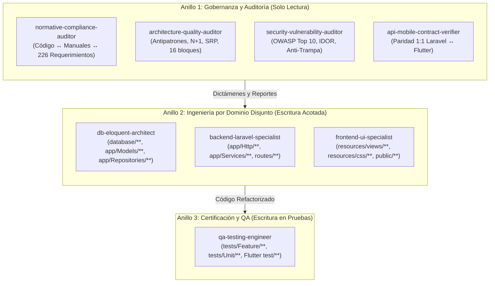

# ADR-015 — Topología de 8 Subagentes Especializados en 3 Anillos (`MSA-V1`)

> **Estado:** Aceptado  
> **Fecha:** 27 de Octubre de 2026  
> **Decisores:** Equipo de Arquitectura A-Code Solutions  
> **Documento Normativo Asociado:** `MSA-V1` ([Manual_de_Subagentes_y_Flujo_de_Trabajo_MSA-V1.md](file:///home/laambws/Descargas/manuales/acode-solutions/07_Manuales_Oficiales_V2/Manual_de_Subagentes_y_Flujo_de_Trabajo_MSA-V1.md))

---

## 1. Contexto y Problemática
El desarrollo y mantenimiento concurrente del ecosistema evaluador (`acs-exam-web` y `acs-exam-mobile`) enfrentaba dos riesgos operacionales graves al delegar tareas a modelos de IA o múltiples ingenieros:
1. **Colisión de archivos concurrentes:** Dos agentes intentando editar los mismos controladores, modelos o vistas al mismo tiempo, provocando condiciones de carrera y sobrescrituras destructivas.
2. **Conflicto de interés y falta de objetividad:** El mismo agente que escribe el código evalúa si cumple la norma, omitiendo deuda técnica o vulnerabilidades evidentes.
3. **Pérdida de trazabilidad con la documentación:** El código evolucionaba desfasándose de los 4 manuales institucionales (`MPW-V2`, `MPM-V1`, `MC-V2`, `MD-V2`) y de las 226 propuestas de la `Lista_maestra_requerimientos.xlsx`.

---

## 2. Decisión de Arquitectura
Se adopta formalmente el estándar **`MSA-V1`**, estructurando el ecosistema en **8 subagentes especializados organizados en 3 anillos jerárquicos**:

### Reglas Inviolables
1. **Auditores del Anillo 1 sin herramientas de escritura (`EnableWriteTools: false`):** Solo inspeccionan y emiten dictámenes tripartitos:
   - **Dictamen A (`CORREGIR_CODIGO`)**: Código incumple la norma.
   - **Dictamen B (`DOCUMENTAR_ADR_DE06`)**: Código supera la norma y se asienta en ADR/DE-06.
   - **Dictamen C (`ACTUALIZAR_MANUAL`)**: Manual presenta contradicción o errata a corregir en `MPW-V2.1`.
2. **Partición Disjunta en el Anillo 2:** Ningún agente de ingeniería puede modificar archivos fuera de su dominio asignado.
3. **Aislamiento de QA en el Anillo 3:** `qa-testing-engineer` solo escribe tests en `tests/**`, certificando con `php artisan test` que nada se rompa.

---

## 3. Consecuencias
- **Positivas:** Cero colisiones de código entre agentes; revisiones exhaustivas y objetivas previas a la escritura; trazabilidad 1:1 con los manuales oficiales de A-Code Solutions; compatibilidad multi-sesión mediante persistencia en `.agents/agents/<nombre>/agent.md` y `AGENTS.md`.
- **Compromisos (Trade-offs):** Mayor tiempo de planeación inicial antes de la ejecución de cambios de código, lo cual se compensa con cero regresiones en producción.
